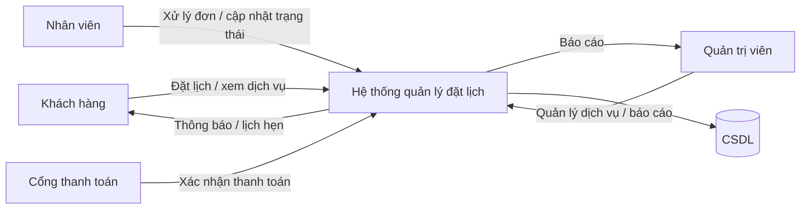
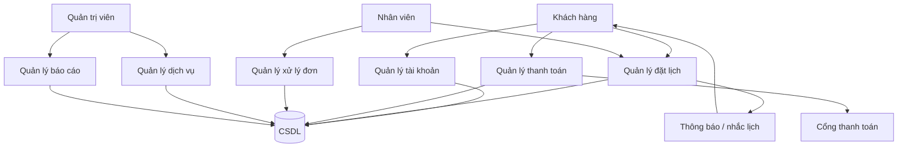

# Giai đoạn 1 - Sơ đồ DFD

## 1. DFD mức 0

## 2. DFD mức 1

## 3. Giải thích luồng dữ liệu
- Khách hàng gửi yêu cầu đăng nhập, xem dịch vụ, đặt lịch và thanh toán.
- Hệ thống lưu trữ dữ liệu vào CSDL và gửi thông báo lại cho người dùng.
- Nhân viên cập nhật trạng thái đơn và ghi nhận kết quả xử lý.
- Quản trị viên quản lý dữ liệu dịch vụ và báo cáo doanh thu.
