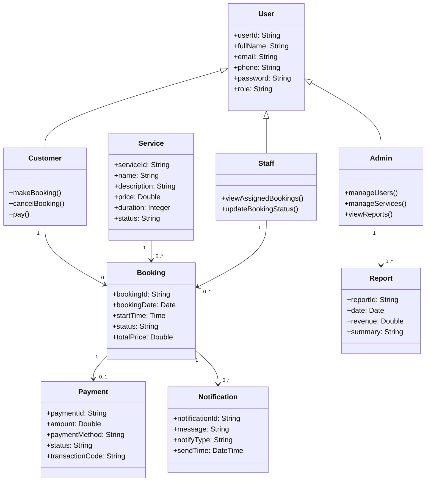

# Giai đoạn 1 - Sơ đồ lớp (Class Diagram)

## 1. Sơ đồ lớp

## 2. Mô tả các lớp chính
- User: lưu thông tin người dùng, phân quyền.
- Customer: khách hàng, thực hiện đặt lịch và thanh toán.
- Staff: nhân viên, xử lý lịch hẹn và cập nhật trạng thái.
- Admin: quản trị viên, quản lý tài nguyên hệ thống.
- Service: mô tả thông tin dịch vụ.
- Booking: đơn đặt lịch.
- Payment: thanh toán cho đơn đặt lịch.
- Notification: thông báo và nhắc lịch.
- Report: báo cáo thống kê.

## 3. Kết luận
Sơ đồ lớp cho thấy mối quan hệ giữa các thực thể trong hệ thống và là nền tảng cho việc thiết kế cơ sở dữ liệu và mã nguồn trong các giai đoạn tiếp theo.
