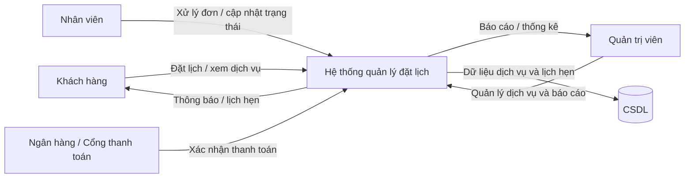
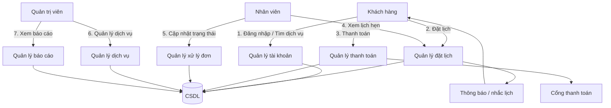
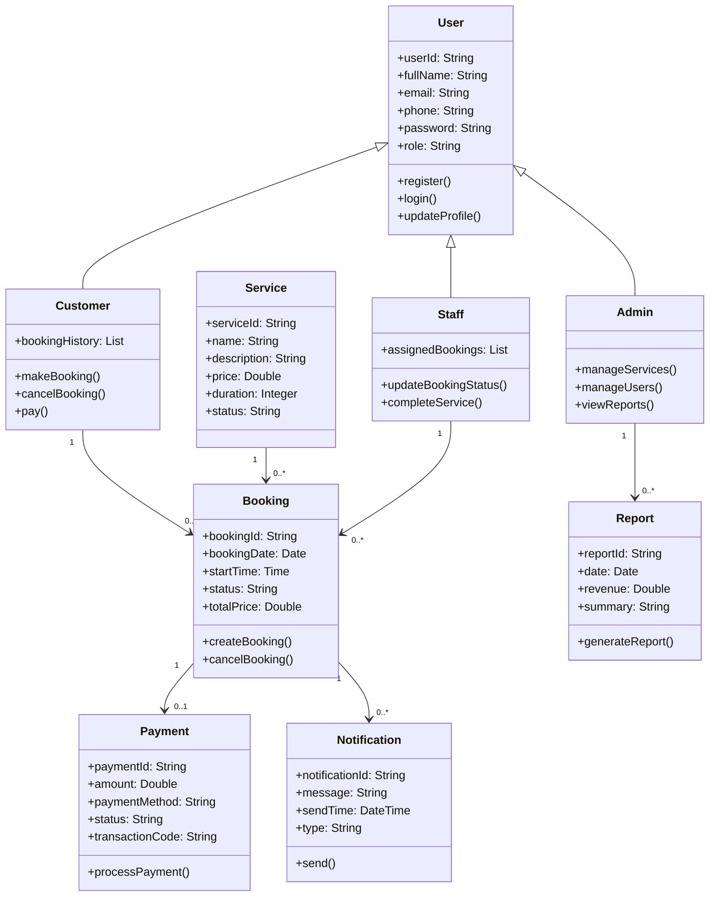

# Giai đoạn 1 - Đặc tả yêu cầu và mô hình phân tích

## 1. Tổng quan hệ thống
Hệ thống quản lý đặt lịch và theo dõi dịch vụ trực tuyến nhằm giúp khách hàng đăng ký dịch vụ, quản lý lịch hẹn, thanh toán và nhận thông báo theo thời gian thực. Hệ thống hỗ trợ nhân viên xử lý đơn, quản lý tài nguyên và báo cáo hoạt động cho quản trị viên.

## 2. Đặc tả yêu cầu

### 2.1 Yêu cầu chức năng

#### 2.1.1 Quản lý người dùng
- Hệ thống cho phép người dùng đăng ký tài khoản bằng email/số điện thoại và mật khẩu.
- Người dùng có thể đăng nhập, đăng xuất và cập nhật thông tin cá nhân.
- Hệ thống phân quyền theo 3 vai trò: Khách hàng, Nhân viên, Quản trị viên.
- Quản trị viên có quyền quản lý tài khoản, cấp quyền và khóa/mở khóa tài khoản.

#### 2.1.2 Quản lý dịch vụ
- Khách hàng có thể xem danh sách dịch vụ, chi tiết, thời gian, giá và trạng thái khả dụng.
- Hệ thống cho phép quản trị viên/nhân viên thêm, sửa, xóa và ngừng kinh doanh dịch vụ.
- Mỗi dịch vụ có thông tin: mã dịch vụ, tên, mô tả, giá, thời lượng, trạng thái.

#### 2.1.3 Đặt lịch / đặt dịch vụ
- Khách hàng có thể đặt lịch theo ngày/giờ phù hợp với dịch vụ đang mở.
- Hệ thống kiểm tra lịch rảnh trước khi xác nhận đặt lịch.
- Khi đặt thành công, hệ thống lưu đơn đặt lịch và gửi thông báo qua email/SMS hoặc ứng dụng.
- Khách hàng có thể xem lịch sử đặt lịch và hủy hoặc đổi lịch trong thời gian cho phép.

#### 2.1.4 Thanh toán
- Hệ thống hỗ trợ thanh toán trực tuyến qua cổng thanh toán hoặc thanh toán trực tiếp khi đến nơi.
- Xác nhận thanh toán được lưu với mã giao dịch, thời gian, trạng thái.
- Hệ thống hiển thị thông tin thanh toán cho khách hàng và nhân viên.

#### 2.1.5 Quản lý lịch làm việc và xử lý đơn
- Nhân viên xem danh sách lịch hẹn được phân công.
- Nhân viên cập nhật trạng thái: chờ xác nhận, đã xác nhận, đang thực hiện, hoàn thành, hủy.
- nhân viên có thể ghi nhận kết quả dịch vụ và đánh giá khách hàng.

#### 2.1.6 Báo cáo và thống kê
- Quản trị viên xem báo cáo doanh thu theo ngày/tháng.
- Hệ thống thống kê số lượng dịch vụ, số đơn đặt lịch, tỷ lệ hoàn thành, tỉ lệ hủy.
- Báo cáo có thể xuất ra file Excel/PDF hoặc xem trực tiếp trên giao diện web.

#### 2.1.7 Thông báo và nhắc lịch
- Hệ thống gửi email/SMS nhắc lịch trước thời gian hẹn.
- Gửi thông báo khi đơn đặt lịch được xác nhận, hoàn thành hoặc bị hủy.
- Người dùng có thể tùy chỉnh nhận thông báo qua email hoặc ứng dụng.

### 2.2 Yêu cầu phi chức năng

#### 2.2.1 Hiệu năng
- Thời gian phản hồi màn hình chính không quá 3 giây với 1000 người dùng đồng thời.
- Hệ thống hỗ trợ tối thiểu 500 giao dịch đặt lịch trong một giờ cao điểm.
- Tốc độ xử lý báo cáo không vượt quá 10 giây cho dữ liệu trung bình.

#### 2.2.2 Tính khả dụng
- Hệ thống hoạt động 99% thời gian trong một năm.
- Hệ thống phải có cơ chế xử lý lỗi và phục hồi dịch vụ khi có sự cố.
- Hệ thống cần có backup dữ liệu hàng ngày.

#### 2.2.3 Bảo mật
- Mật khẩu được mã hóa bằng thuật toán băm an toàn (ví dụ: bcrypt/argon2).
- Dữ liệu thanh toán không lưu trực tiếp thông tin thẻ, chỉ lưu token hoặc mã giao dịch.
- Hệ thống hỗ trợ xác thực phân quyền theo vai trò.
- Kết nối giữa client-server phải thực hiện qua HTTPS.

#### 2.2.4 Khả năng mở rộng
- Hệ thống có thể mở rộng để thêm nhiều loại dịch vụ mới, kênh thanh toán và chức năng báo cáo.
- Kiến trúc phân tầng (presentation, application, data) giúp dễ nâng cấp.

#### 2.2.5 Khả năng sử dụng
- Giao diện thân thiện, dễ sử dụng cho người mới.
- Màn hình có bố cục rõ ràng, tiêu đề, nút thao tác dễ nhận biết.
- Hệ thống hỗ trợ tiếng Việt và tiếng Anh cơ bản.

#### 2.2.6 Tính bảo trì
- Mã nguồn phải được tổ chức theo mô-đun, dễ bảo trì và kiểm thử.
- Cấu trúc dữ liệu rõ ràng, dễ mở rộng và tích hợp API mới.

## 3. Sơ đồ DFD (Data Flow Diagram)

### 3.1 DFD mức 0


### 3.2 DFD mức 1


## 4. Sơ đồ Use Case
```mermaid
flowchart LR
    actor KhachHang[Khách hàng]
    actor NhanVien[Nhân viên]
    actor QuanTri[Quản trị viên]
    actor ThanhToan[Cổng thanh toán]

    subgraph Hethong[Hệ thống quản lý đặt lịch]
        UC1[Đăng ký tài khoản]
        UC2[Đăng nhập]
        UC3[Xem danh sách dịch vụ]
        UC4[Đặt lịch]
        UC5[Thanh toán]
        UC6[Xem lịch sử đơn]
        UC7[Hủy / đổi lịch]
        UC8[Xem đơn được phân công]
        UC9[Cập nhật trạng thái hẹn]
        UC10[Quản lý dịch vụ]
        UC11[Xem báo cáo]
        UC12[Quản lý tài khoản]
    end

    KhachHang --> UC1
    KhachHang --> UC2
    KhachHang --> UC3
    KhachHang --> UC4
    KhachHang --> UC5
    KhachHang --> UC6
    KhachHang --> UC7

    NhanVien --> UC8
    NhanVien --> UC9

    QuanTri --> UC10
    QuanTri --> UC11
    QuanTri --> UC12

    ThanhToan --> UC5
```

### Mô tả Use Case chính
- UC01: Đăng ký tài khoản — Người dùng tạo tài khoản mới trong hệ thống.
- UC02: Đăng nhập — Xác thực tài khoản và phân quyền.
- UC03: Xem dịch vụ — Khách hàng xem thông tin dịch vụ, giá và lịch trống.
- UC04: Đặt lịch — Khách hàng chọn dịch vụ và thời gian phù hợp.
- UC05: Thanh toán — Hệ thống xác nhận thanh toán và lưu giao dịch.
- UC08: Xem đơn được phân công — Nhân viên xem các lịch hẹn cần xử lý.
- UC09: Cập nhật trạng thái — Nhân viên cập nhật tiến độ thực hiện dịch vụ.
- UC10: Quản lý dịch vụ — Quản trị viên quản lý danh mục dịch vụ.
- UC11: Xem báo cáo — Quản trị viên thống kê doanh thu và hiệu suất.

## 5. Sơ đồ lớp (Class Diagram)


## 6. Ràng buộc nghiệp vụ chính
- Một khách hàng chỉ có thể đặt một lịch trong cùng một khung giờ cho cùng một dịch vụ.
- Mỗi đơn đặt lịch phải có trạng thái rõ ràng: chờ xác nhận, đã xác nhận, hoàn thành, hủy.
- Dịch vụ không còn hoạt động thì không được phép khách hàng đặt lịch mới.
- Chỉ quản trị viên mới có quyền xóa dịch vụ vĩnh viễn, nhân viên chỉ có quyền cập nhật trạng thái.
- Hệ thống phải lưu trữ lịch sử thanh toán và giao dịch để đối soát.

## 7. Kết luận
Giai đoạn 1 xác định rõ phạm vi hệ thống, yêu cầu chức năng và phi chức năng, đồng thời mô hình hóa luồng dữ liệu, tương tác người dùng và cấu trúc dữ liệu. Những mô hình này làm nền tảng cho giai đoạn thiết kế chi tiết ở các bước tiếp theo.

## 8. Tài liệu tham khảo
- Sơ đồ DFD, Use Case và Class Diagram được xây dựng theo mô hình phân tích hệ thống hướng đối tượng và luồng dữ liệu.
- Dùng làm cơ sở cho giai đoạn phát triển tiếp theo: thiết kế giao diện, database và API.
