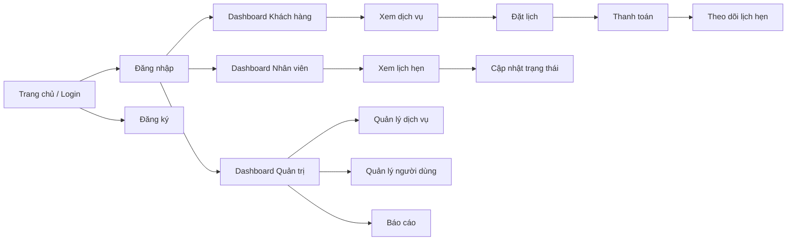

# Giai đoạn 2 - Thiết kế giao diện GUI

## 1. Mục tiêu
Thiết kế giao diện tập trung vào trải nghiệm người dùng, giúp khách hàng dễ đặt lịch, theo dõi trạng thái và thanh toán; giúp nhân viên và quản trị viên quản lý công việc hiệu quả.

## 2. Vai trò người dùng
- Khách hàng: đăng nhập, xem dịch vụ, đặt lịch, thanh toán, theo dõi lịch hẹn.
- Nhân viên: xem lịch hẹn và cập nhật trạng thái.
- Quản trị viên: quản lý dịch vụ, báo cáo, quản lý người dùng.

## 3. Giao diện chính đề xuất
### 3.1 Màn hình đăng nhập
- Email/SĐT
- Mật khẩu
- Nút Đăng nhập
- Link quên mật khẩu, đăng ký

### 3.2 Màn hình đăng ký
- Họ tên
- Email
- Số điện thoại
- Mật khẩu
- Xác nhận mật khẩu

### 3.3 Dashboard khách hàng
- Header: logo + menu điều hướng
- Thẻ thống kê: số lịch hẹn, lịch sắp tới, số hóa đơn
- Danh sách dịch vụ nổi bật
- Lịch sử đặt lịch gần đây

### 3.4 Màn hình danh sách dịch vụ
- Filter theo danh mục, giá, thời lượng
- Card dịch vụ với hình ảnh, tên, mô tả, giá
- Nút “Đặt lịch”

### 3.5 Màn hình đặt lịch
- Chọn dịch vụ
- Chọn ngày và giờ
- Ghi chú
- Nút xác nhận

### 3.6 Màn hình thanh toán
- Chọn phương thức thanh toán
- Tổng tiền
- Nút thanh toán
- Hiển thị mã giao dịch

### 3.7 Màn hình quản lý nhân viên
- Danh sách lịch hẹn
- Trạng thái: chờ xác nhận, đang thực hiện, hoàn thành
- Nút cập nhật trạng thái

### 3.8 Màn hình quản trị viên
- Quản lý dịch vụ
- Quản lý người dùng
- Thống kê doanh thu
- Xuất báo cáo

## 4. Sơ đồ điều hướng

## 5. Nguyên tắc thiết kế
- Tối giản, dễ hiểu, nhất quán màu sắc và bố cục.
- Giao diện có thể responsive trên desktop và mobile.
- Mỗi chức năng cần có phản hồi rõ ràng sau khi thao tác.
- Ít thao tác nhất để hoàn thành 1 nhiệm vụ.

## 6. Kết luận
Thiết kế GUI cần đáp ứng nhu cầu của 3 vai trò người dùng với giao diện rõ ràng, dễ thao tác và tối ưu trải nghiệm.
