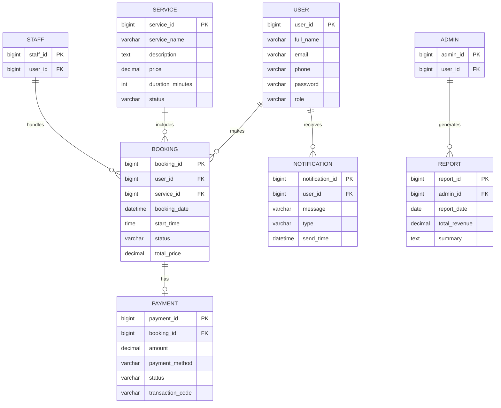

# Giai đoạn 2 - Thiết kế cơ sở dữ liệu

## 1. Mục tiêu
Thiết kế cơ sở dữ liệu nhằm lưu trữ dữ liệu người dùng, dịch vụ, đặt lịch, thanh toán và báo cáo theo chuẩn rõ ràng, dễ quản lý và mở rộng.

## 2. ERD đề xuất

## 3. Bảng dữ liệu và mô tả

### 3.1 Bảng User
| Tên cột | Kiểu dữ liệu | Mô tả |
| --- | --- | --- |
| user_id | BIGINT PK | Mã người dùng |
| full_name | VARCHAR | Họ tên |
| email | VARCHAR | Email đăng nhập |
| phone | VARCHAR | Số điện thoại |
| password | VARCHAR | Mật khẩu đã mã hóa |
| role | VARCHAR | Vai trò: customer, staff, admin |

### 3.2 Bảng Service
| Tên cột | Kiểu dữ liệu | Mô tả |
| --- | --- | --- |
| service_id | BIGINT PK | Mã dịch vụ |
| service_name | VARCHAR | Tên dịch vụ |
| description | TEXT | Mô tả dịch vụ |
| price | DECIMAL | Giá dịch vụ |
| duration_minutes | INT | Thời lượng dịch vụ |
| status | VARCHAR | Trạng thái: active/inactive |

### 3.3 Bảng Booking
| Tên cột | Kiểu dữ liệu | Mô tả |
| --- | --- | --- |
| booking_id | BIGINT PK | Mã đặt lịch |
| user_id | BIGINT FK | Khách hàng đặt lịch |
| service_id | BIGINT FK | Dịch vụ được đặt |
| booking_date | DATETIME | Ngày đặt lịch |
| start_time | TIME | Giờ bắt đầu |
| status | VARCHAR | Trạng thái đơn |
| total_price | DECIMAL | Tổng tiền |

### 3.4 Bảng Payment
| Tên cột | Kiểu dữ liệu | Mô tả |
| --- | --- | --- |
| payment_id | BIGINT PK | Mã thanh toán |
| booking_id | BIGINT FK | Mã đơn đặt lịch |
| amount | DECIMAL | Số tiền thanh toán |
| payment_method | VARCHAR | QR, thẻ, tiền mặt... |
| status | VARCHAR | success/pending/failed |
| transaction_code | VARCHAR | Mã giao dịch |

### 3.5 Bảng Notification
| Tên cột | Kiểu dữ liệu | Mô tả |
| --- | --- | --- |
| notification_id | BIGINT PK | Mã thông báo |
| user_id | BIGINT FK | Người nhận |
| message | TEXT | Nội dung thông báo |
| type | VARCHAR | Loại thông báo |
| send_time | DATETIME | Thời gian gửi |

### 3.6 Bảng Report
| Tên cột | Kiểu dữ liệu | Mô tả |
| --- | --- | --- |
| report_id | BIGINT PK | Mã báo cáo |
| admin_id | BIGINT FK | Người tạo báo cáo |
| report_date | DATE | Ngày báo cáo |
| total_revenue | DECIMAL | Tổng doanh thu |
| summary | TEXT | Nội dung tóm tắt |

## 4. Khóa chính và khóa ngoại
- Khóa chính:
  - user_id, service_id, booking_id, payment_id, notification_id, report_id
- Khóa ngoại:
  - Booking.user_id tham chiếu User.user_id
  - Booking.service_id tham chiếu Service.service_id
  - Payment.booking_id tham chiếu Booking.booking_id
  - Notification.user_id tham chiếu User.user_id
  - Report.admin_id tham chiếu Admin.admin_id

## 5. Ràng buộc dữ liệu
- Một booking phải thuộc về một user và một service.
- Mỗi booking chỉ có tối đa một payment chính.
- Mỗi user chỉ có một vai trò duy nhất.
- Trạng thái booking và payment phải được lưu rõ ràng.
- Không cho phép đặt lịch trùng khung giờ cho cùng một dịch vụ.

## 6. Kết luận
Thiết kế CSDL đảm bảo lưu trữ dữ liệu theo mô hình quan hệ, với các khóa chính, khóa ngoại và ràng buộc dữ liệu rõ ràng, phù hợp cho hệ thống quản lý dịch vụ và đặt lịch.
